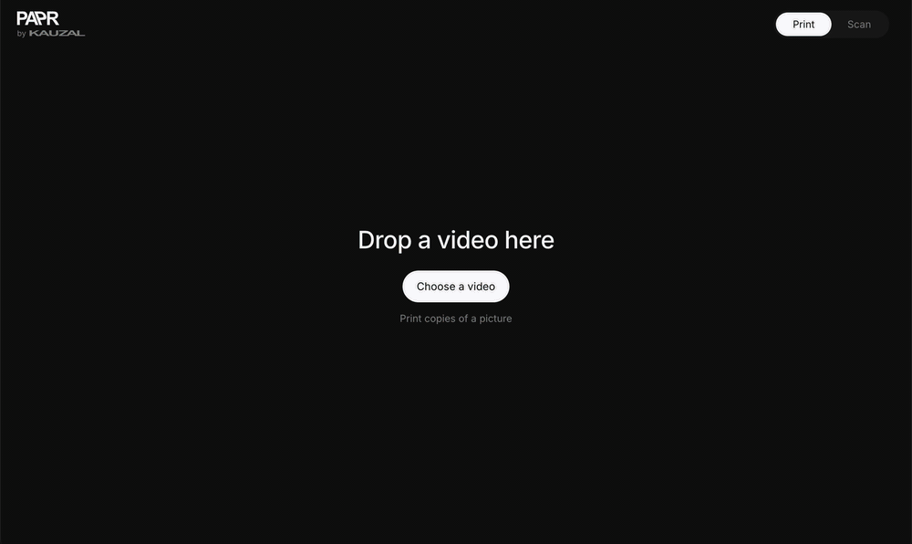
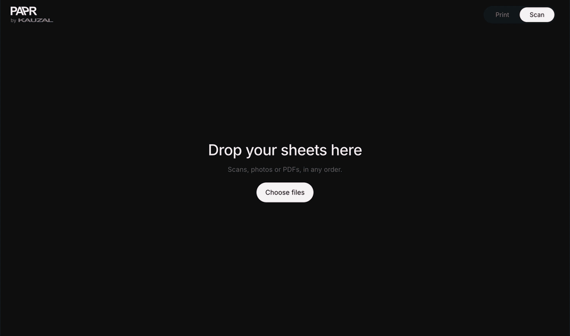

# PAPR

<p align="left">
  <a href="LICENSE"></a>
  
  
  
</p>

A mixed media animation tool. PAPR turns a video into printable sheets of frames, and the painted, cut or glued sheets back into a video.

Working on an animation by hand means working on every single frame. Getting those frames back into the computer usually means scanning page after page and lining up each frame by hand in an editor. PAPR does that part: it reads the scans, finds every frame and puts the animation back together.

Everything runs in the browser. No account, nothing gets uploaded.

<br/>

## Print



## Scan



<br/>

## How it works

1. Print: drop a video, choose frame rate, crop and paper, download the sheets as a PDF.
2. Make: draw, paint, cut or glue on the printed frames.
3. Scan: scan or photograph the sheets, drop them in, download the animation.

Every sheet carries four corner marks and a QR code with the project, sheet number and layout. Sheets can be scanned in any order, as single images or as a multi-page PDF.

## Features

| Print | |
|---|---|
| Timeline | Several videos on one timeline. Cut, trim, move, undo. Sound can be separated onto its own track. |
| Frames | 6, 8, 12, 15 or 24 fps. Crop per clip, choice of frames per sheet. |
| Paper | A3, A4, A5 or Letter, portrait or landscape. Optional white border and frame numbers. |
| Scan with | Scanner prints only the corners and the QR code. Phone or tablet adds small markers between the frames for photos taken at an angle or of paper that is not flat. |
| Copies | Prints one frame or your own picture in a grid at the same size as the animation frames, without marks. Brightness and invert for prints that come out too dark. |

| Scan | |
|---|---|
| Input | Scanner images, phone photos and PDFs. Missing sheets are skipped, so a first look works with only a few sheets. |
| Detection | Finds the corners and the QR code, measures the frame edges and corrects bent or wavy paper. |
| Playback | Frame rate, boomerang, repeat. Sound from the original video, cut to match the frames. |
| Export | MP4, GIF or every frame as PNG in a ZIP. Three sizes, trim edges, keep or remove the white border. |

## Accuracy

Measured on generated test scans (A4 landscape, 76 mm frames). Error in percent of the frame width, mean / max.

| Scenario | Scanner sheet | Phone sheet |
|---|---|---|
| Scanner, 300 dpi | 0.06 / 0.17 | 0.06 / 0.12 |
| Phone photo at an angle | 0.14 / 0.60 | 0.09 / 0.29 |
| Wavy paper | 0.49 / 2.09 | 0.14 / 0.83 |
| Painted, phone photo | 0.76 / 4.06 | 0.17 / 0.70 |

The test scans come from `npm run lab`, which prints the sheets, distorts them like a scanner or phone would and measures the detection against the known positions.

## Run locally

Requires Node.js 22.18 or newer.

```bash
git clone https://github.com/victoraci/papr.git
cd papr
npm install
npm run dev
```

Then open http://localhost:5180.

`npm run build` writes a static site to `dist/` that can be hosted anywhere. `npm run lab` additionally needs `pdftoppm` from [Poppler](https://poppler.freedesktop.org).

## Built with

TypeScript, Vite, [OpenCV.js](https://docs.opencv.org/) (WebAssembly), [Mediabunny](https://mediabunny.dev) (WebCodecs), [pdf-lib](https://pdf-lib.js.org), [PDF.js](https://mozilla.github.io/pdf.js/), [jsQR](https://github.com/cozmo/jsQR), [gifenc](https://github.com/mattdesl/gifenc), [fflate](https://github.com/101arrowz/fflate), [Inter](https://rsms.me/inter/).

## License

[AGPL-3.0](LICENSE). PAPR is free to use, change and share. Anyone who publishes a changed version, including as a website or paid service, has to release its source code under the same license.
